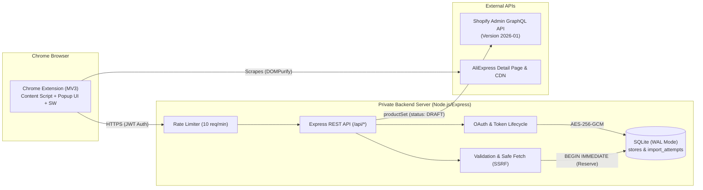

# AliExpress to Shopify One-Click Importer

A lightweight, security-first Chrome Extension and Node.js backend that imports a single product from an open AliExpress detail page directly into a connected Shopify store as a **Draft** with one click.

> [!NOTE]
> **Implementation Status: Complete (Milestones M0–M9)**
>
> All 86 planned tasks across all 10 milestones have been implemented and verified.
> The full test suite includes **130 passing tests across 19 suites** covering OAuth, token encryption, multi-strategy scraping, decimal-safe pricing, SQLite write-ahead reservation, duplicate prevention, concurrency races, Shopify GraphQL mutations, SSRF guards, and rate limiting.

---

## 1. Key Features

- **Single-Click Draft Import** — One-click action imports product details into Shopify strictly as a Draft (never published automatically).
- **In-Popup Product Preview** — View product thumbnail, title, extracted variant count, and image count before initiating import.
- **Currency Verification** — Strictly verifies that the AliExpress display currency matches the connected Shopify store base currency before allowing import.
- **Configurable Decimal-Safe Markup** — Set a percentage markup (e.g., 30%) with commercial half-up rounding and zero floating-point arithmetic errors.
- **Option & Variant Integrity** — Accurately maps option dimensions (up to Shopify's limit of 3) and variant combinations; explicitly rejects products with > 3 options (never silently truncates).
- **Transparent Image Handling** — Attempts direct CDN pass-through with staged upload fallback; popup explicitly communicates whether all or some images imported (`completed` vs. `completed_partial_images`).
- **Concurrency-Safe Duplicate Prevention** — Implements an import reservation state machine (`pending` → `completed` / `failed` / `needs_reconciliation`) to prevent duplicate creation under parallel requests or ambiguous timeouts.
- **Zero Secrets in Extension** — Shopify Admin access tokens and client secrets are stored exclusively server-side (encrypted with AES-256-GCM); the extension receives only a short-lived, exchangeable authorization token.
- **SSRF & Network Hardening** — Pre-resolution DNS verification blocks loopback (`127.0.0.0/8`), private (`10.0.0.0/8`, `172.16.0.0/12`, `192.168.0.0/16`), and link-local (`169.254.0.0/16`) ranges. Strict 1 MB request body caps and sliding-window rate limiting (10 req/min).

---

## 2. System Architecture



---

## 3. Technology Stack

| Component | Technology | Rationale |
|-----------|------------|-----------|
| **Chrome Extension** | Manifest V3, TypeScript, CSS | Modern browser standard; strict CSP compliance |
| **Backend Server** | Node.js (v24 native `node:sqlite`), Express | High performance, synchronous WAL persistence, zero native compiler dependencies |
| **Database** | SQLite via built-in `node:sqlite` (`DatabaseSync`) | Zero-configuration embedded database; ACID transactions; `BEGIN IMMEDIATE` write lock |
| **Token Encryption** | AES-256-GCM (`node:crypto`) | Authenticated encryption with unique IV and auth tag per token |
| **Shopify API** | Admin GraphQL API (`2026-01`) | Synchronous `productSet` mutation creating Draft products |
| **HTML Sanitization** | DOMPurify (client) + `sanitize-html` (server) | Defense-in-depth XSS prevention for imported descriptions |
| **Build System** | esbuild & `tsc` | Fast bundle times for content scripts, service worker, and popup UI |
| **Test Runner** | Vitest 5 | 130 unit, integration, and concurrency race tests |

---

## 4. Quick Start Guide

### 4.1 Prerequisites

- **Node.js**: v20+ LTS or v24+
- **Google Chrome**: Version 120+ (Manifest V3 support)
- **Shopify Partner / Dev Store**: A development store to test draft product creation.

---

### 4.2 Setting Up the Backend Server

1. **Navigate to the server directory and configure environment:**
   ```bash
   cd server
   cp .env.example .env
   ```
2. **Fill in your environment variables in `.env`:**
   - `SHOPIFY_CLIENT_ID`: Client ID from Shopify Partner Dashboard.
   - `SHOPIFY_CLIENT_SECRET`: Client Secret from Shopify Partner Dashboard.
   - `JWT_SECRET`: 32-byte hex secret (`openssl rand -hex 32`).
   - `ENCRYPTION_KEY`: 32-byte hex key for token encryption (`openssl rand -hex 32`).
   - `EXTENSION_ID`: The Chrome extension ID (from `chrome://extensions`).
3. **Build and start the server:**
   ```bash
   npm run build
   npm start
   ```
   The backend server will start on `http://localhost:3456`.
   Verify health:
   ```bash
   curl http://localhost:3456/health
   # Returns: {"status":"healthy","database":"connected","active_store":...}
   ```

---

### 4.3 Loading the Chrome Extension

1. **Build the extension bundle:**
   ```bash
   npm run build -w extension
   ```
   This generates the production bundle inside `extension/dist/`.
2. **Load unpacked in Chrome:**
   - Open Chrome and navigate to `chrome://extensions/`.
   - Enable **Developer mode** (toggle in upper right).
   - Click **Load unpacked** and select the `c:\Users\Hi\OneDrive\Pictures\aliexpres-oneclick-import\extension` folder (or `extension/` directory containing `manifest.json`).
3. **Record the Extension ID:**
   - Copy the generated Extension ID (e.g. `abcdefghijklmnop...`) and update `EXTENSION_ID` in `server/.env`.

---

### 4.4 Running Automated Tests

Run all 130 unit and integration tests across both workspaces:
```bash
npm test
```
To run tests by workspace:
```bash
npm test -w server     # 13 test suites (88 tests)
npm test -w extension  # 6 test suites (42 tests)
```

---

## 5. Operations & Disaster Recovery

### Database Backup
SQLite WAL mode allows online backups without stopping the server:
```bash
sqlite3 data/importer.db ".backup data/importer-backup.db"
```

### Database Verification
To verify SQLite database integrity:
```bash
sqlite3 data/importer.db "PRAGMA integrity_check;"
```

---

## 6. Canonical Documentation Index

| Document | Purpose & Scope |
|----------|-----------------|
| [plan.md](plan.md) | High-level requirements, supported product envelope, and acceptance criteria |
| [architecture.md](architecture.md) | Component architecture, data flows, security boundaries, and reservation state machine |
| [decisions.md](decisions.md) | 14 Architectural Decision Records (ADRs) covering MV3, SQLite, OAuth, currency, and images |
| [rules.md](rules.md) | 20 mandatory engineering rules governing security, money arithmetic, and scope control |
| [database-schema.md](database-schema.md) | SQLite database schema (`stores`, `import_attempts`), migrations, encryption, and operations |
| [api-spec.md](api-spec.md) | Complete REST API contract, request/response schemas, error codes, and GraphQL mutations |
| [design.md](design.md) | UI/UX specification, 12 discrete popup states, ASCII wireframes, and accessibility requirements |
| [testing.md](testing.md) | Comprehensive test matrix (unit, integration, SSRF security, concurrency races, E2E) |
| [deployment.md](deployment.md) | Development setup, production Docker/Nginx topology, disaster recovery, and backups |
| [tasks.md](tasks.md) | 86 implementation tasks organized across 10 milestones (M0–M9) with status |
| [planning-audit.md](planning-audit.md) | Audit report tracking all 20 findings (F-01 through F-20) and remediation status |
| [README.md](README.md) | Project summary, status, and developer orientation (this file) |

---

## 7. Compliance & Merchant Responsibility

- **Draft Only**: All products are created strictly as Drafts. The merchant retains full review authority before publishing products to customers.
- **Intellectual Property**: Merchants are solely responsible for ensuring proper licensing and supplier authorization for imported images and descriptions.
- **Single Active Store**: Connecting a new Shopify store automatically deactivates the previously connected store.
