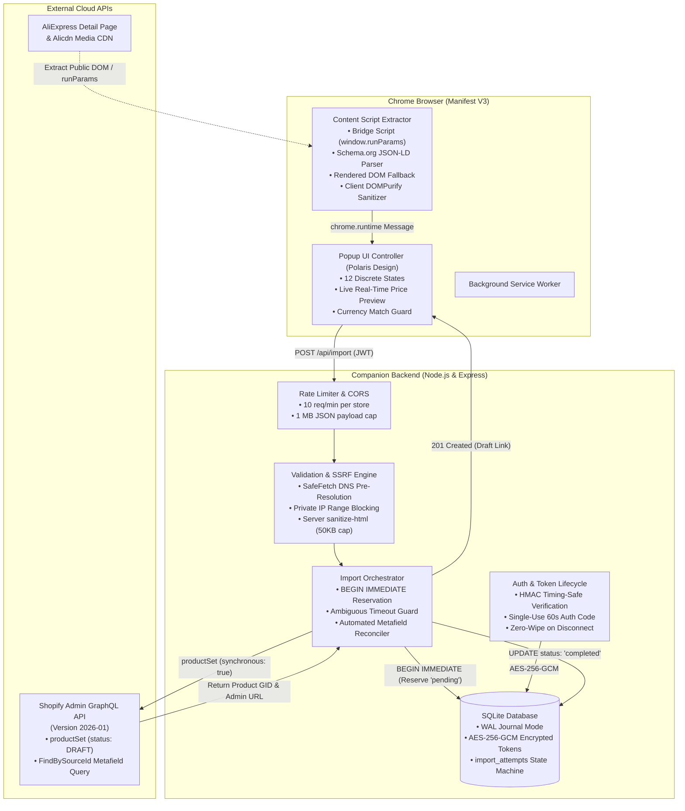
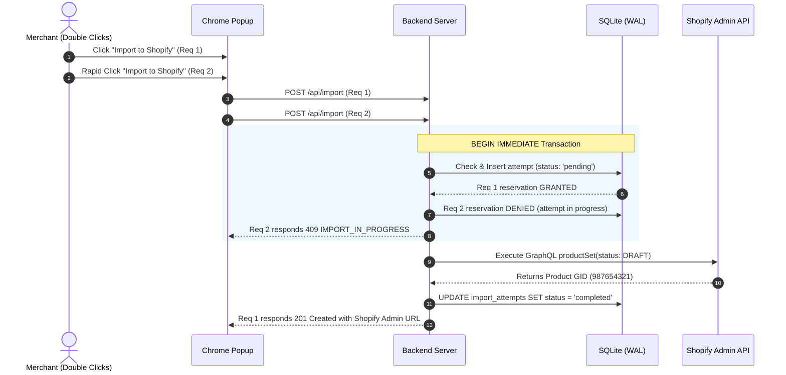

<div align="center">

# ⚡ AliExpress to Shopify One-Click Importer

<p align="center">
  <strong>Production-ready Chrome Extension (Manifest V3) and companion Node.js backend to import any AliExpress product directly into your Shopify store as a Draft in one click.</strong>
</p>

<p align="center">
  <a href="https://github.com/nizamuddin3080/Aliexpress-oneclick-import/actions"></a>
  <a href="https://shopify.dev/docs/api/admin-graphql"></a>
  <a href="https://developer.chrome.com/docs/extensions/develop"></a>
  <a href="https://nodejs.org/"></a>
  <a href="https://sqlite.org/"></a>
  <a href="https://www.typescriptlang.org/"></a>
  <a href="LICENSE"></a>
</p>

<p align="center">
  <a href="#-key-features">Key Features</a> •
  <a href="#-why-this-exists-comparison">Why This Exists</a> •
  <a href="#-system-architecture">Architecture</a> •
  <a href="#-ui-walkthrough--preview">UI Walkthrough</a> •
  <a href="#-quick-start-guide">Quick Start</a> •
  <a href="#-api-reference">API Reference</a> •
  <a href="#-security--reliability-deep-dive">Security Deep Dive</a> •
  <a href="#-automated-testing">Testing</a> •
  <a href="#-canonical-documentation">Documentation</a>
</p>

---

</div>

## 🌟 Highlights

- **🔒 Strictly Draft-Only** — Products are created with `status: "DRAFT"`. No code path or config flag can publish directly to store customers, keeping merchants in 100% control.
- **🛡️ Zero-Secret Client Extension** — Access tokens and client secrets are stored exclusively server-side (AES-256-GCM encrypted in SQLite). The extension receives only a short-lived bearer JWT.
- **⚡ Concurrency-Safe Reservation** — SQLite `BEGIN IMMEDIATE` write-ahead lock stops race conditions and duplicate creation under parallel clicks or network timeouts.
- **💵 Decimal-Safe Money Math** — Custom integer-cent arithmetic engine with commercial half-up rounding. Eliminates binary floating-point drift (e.g. `0.1 + 0.2 !== 0.3`).
- **💱 Strict Currency Matching** — Compares the AliExpress display currency (ISO 4217) with the connected Shopify store currency. Halts and blocks import on mismatch.
- **📦 3-Option Limit Guard** — Strictly respects Shopify's hard 3-option ceiling. Rejects products with 4+ options with clear guidance (never silently truncates variants).
- **🖼️ Transparent Image Accounting** — Direct CDN pass-through (`originalSource`). Distinguishes full upload success from partial image failures (`completed` vs. `completed_partial_images`).
- **🛡️ SSRF & Network Hardening** — Pre-resolution DNS verification blocks private (`10.x`, `172.16-31.x`, `192.168.x`), loopback (`127.x`), and AWS cloud metadata (`169.254.169.254`) ranges.

---

## 🥊 Why This Exists (Comparison)

Most AliExpress importers are brittle browser-only scripts that store unencrypted tokens in browser storage and fail under real-world conditions. This project was engineered from the ground up for reliability, data integrity, and enterprise security:

| Challenge | Naive Browser-Only Scrapers | **AliExpress One-Click Importer** |
|---|---|---|
| **Shopify Credentials** | Stored in `chrome.storage.local` (accessible to XSS or rogue extensions) | **Zero browser secrets**: Encrypted with AES-256-GCM server-side; 7-day bearer JWT handoff |
| **Duplicate Prevention** | Client-side check only (double-clicking creates 2 products in Shopify) | **`BEGIN IMMEDIATE` SQLite write-ahead reservation**; racers receive HTTP 409 Conflict |
| **Network Timeouts** | Blind retries generate duplicate Shopify listings | Flags attempt as **`needs_reconciliation`**; queries Shopify by source ID metafield before retry |
| **Price Markup Calculations** | JavaScript float math: `$19.99 * 1.3 = $25.987000000000002` | **Integer-cent arithmetic** with commercial half-up rounding: `$25.99` |
| **Currency Differences** | Imports blindly without checking if EUR is imported into a USD store | **Strict ISO 4217 verification**: Blocks import on currency mismatch with actionable UI warning |
| **Option Overflows (>3)** | Silently truncates or merges options, corrupting catalog variants | **Rejects import** with `UNSUPPORTED_PRODUCT`; zero silent variant loss |
| **Product Status** | Often publishes directly as `ACTIVE` without merchant review | **Hardcoded strictly to `DRAFT`**; never publishes automatically |
| **Image Failures** | Claims success even when CDN images fail to load | **Transparent accounting**: distinguishes `completed` from `completed_partial_images` |

---

## 🏗️ System Architecture



### Concurrency Write-Ahead Reservation Flow



---

## 📱 UI Walkthrough & Preview

The extension popup delivers a clean, responsive Shopify Polaris-inspired experience (400×520px) managing **12 discrete operational states**:

```
+-------------------------------------------------------+
|  AliExpress Importer             🟢 Demo Store (USD)  |
+-------------------------------------------------------+
|                                                       |
|  [THUMBNAIL]  Wireless Bluetooth Earbuds TWS          |
|  [  IMAGE  ]  Source: AliExpress | ID: 10050061234567 |
|                                                       |
|  Variants: 6 combinations (Color: 3, Style: 2)        |
|  Images: 4 high-res photos                            |
|                                                       |
|  ---------------------------------------------------  |
|  Source Price:          $15.00 - $22.00 USD           |
|  Markup Percentage:     [ 30 ] %                      |
|  Selling Price (Draft): $19.50 - $28.60 USD           |
|  ---------------------------------------------------  |
|                                                       |
|  [       🚀 Import to Shopify as Draft       ]        |
|                                                       |
|  ℹ️ Will be imported as Draft. Review before selling.  |
+-------------------------------------------------------+
```

### Complete UI State Machine

```
[ Disconnected ] ──(Connect Store)──> [ OAuth Callback ] ──(Store Active)──> [ Idle / Inspecting ]
                                                                                   │
       ┌───────────────────────────────┬───────────────────────────────┬───────────┴───────────┐
       ▼                               ▼                               ▼                       ▼
[ Non-AliExpress ]            [ Currency Mismatch ]          [ Unsupported Options ]      [ Extracting... ]
 (Shows guide)                 (AE: EUR ≠ Store: USD)         (> 3 Option Dimensions)          │
                                                                                               ▼
                                                                                      [ Product Preview ]
                                                                                      (Thumbnail, Title,
                                                                                       Variants, Markup,
                                                                                       Calculated Price)
                                                                                               │
                                                                                   (Click "Import to Shopify")
                                                                                               │
                                                                                               ▼
                                                                                       [ Importing... ]
                                                                                               │
                              ┌────────────────────────────────┬───────────────────────────────┤
                              ▼                                ▼                               ▼
                     [ 201 Full Success ]        [ 201 Partial Images ]              [ 409 Duplicate ]
                      (Clickable Shopify          (Clickable Draft Link +             (Link to existing
                       Admin Draft Link)           Warning: X of Y failed)             Shopify Product)
```

---

## 📁 Repository Directory Structure

```
aliexpres-oneclick-import/
├── extension/                       # Chrome Extension (Manifest V3)
│   ├── manifest.json                # Pinned permissions: activeTab, scripting, storage
│   ├── build.mjs                    # esbuild bundler script (outputs to dist/)
│   ├── src/
│   │   ├── background/              # MV3 background service worker
│   │   ├── content/                 # Scraper engine (URL parser, currency, sanitizer, bridge)
│   │   │   ├── bridge.ts            # Main-world window.runParams script injector
│   │   │   ├── currency.ts          # ISO 4217 symbol/code extractor and normalizer
│   │   │   ├── dom-parser.ts        # Rendered DOM fallback scraper
│   │   │   ├── jsonld-parser.ts     # Schema.org structured data extractor
│   │   │   ├── orchestrator.ts      # Multi-strategy priority chain + 3-option guard
│   │   │   ├── sanitizer.ts         # Client-side DOMPurify HTML sanitizer
│   │   │   ├── script-parser.ts     # In-page runParams object parser
│   │   │   └── url-parser.ts        # HTTPS AliExpress allowlist validator
│   │   ├── popup/                   # Polaris-inspired popup UI
│   │   │   ├── popup.html           # 12 discrete state containers
│   │   │   ├── popup.css            # Responsive styles and color tokens
│   │   │   ├── popup.ts             # State machine & real-time pricing calculator
│   │   │   ├── auth-callback.html   # OAuth redirect landing page
│   │   │   └── auth-callback.ts     # Auth code exchange & JWT storage
│   │   └── shared/                  # Pricing math and shared type interfaces
│   └── tests/                       # 6 Extension test suites (Vitest + JSDOM)
│
├── server/                          # Companion Backend (Node.js & Express)
│   ├── package.json                 # Node.js 24 native SQLite (DatabaseSync)
│   ├── .env.example                 # Complete configuration template
│   ├── src/
│   │   ├── app.ts                   # Express app with CORS & 1MB JSON limits
│   │   ├── config.ts                # Dynamic getter configuration loader
│   │   ├── index.ts                 # HTTP server listener
│   │   ├── auth/                    # OAuth, HMAC verification, AES-256-GCM crypto, JWT handoff
│   │   ├── db/                      # SQLite WAL database & BEGIN IMMEDIATE reservations
│   │   ├── middleware/              # Sliding-window rate limiter & CORS origins
│   │   ├── routes/                  # Express endpoints (/auth, /api/status, /api/import, /health)
│   │   ├── services/                # Product import orchestrator & decimal pricing
│   │   ├── shopify/                 # GraphQL Admin client (2026-01), productSet, reconciliation
│   │   └── validation/              # SafeFetch SSRF guard, import schema validator, HTML sanitizer
│   └── tests/                       # 13 Server test suites (unit, integration, concurrency)
│
├── data/                            # SQLite persistent storage volume
└── *.md                             # 12 Canonical architecture, API, and audit specifications
```

---

## ⚡ Quick Start Guide

### 1. Prerequisites

- **Node.js**: v20+ LTS or v24+
- **Google Chrome**: Version 120+ (Manifest V3 support)
- **Shopify Partner / Development Store**: A free development store to test draft product creation.

---

### 2. Backend Setup

```bash
# 1. Clone repository
git clone https://github.com/nizamuddin3080/Aliexpress-oneclick-import.git
cd Aliexpress-oneclick-import

# 2. Configure environment variables
cd server
cp .env.example .env

# Generate secure 32-byte hex keys:
node -e "console.log('JWT_SECRET=' + require('crypto').randomBytes(32).toString('hex'))"
node -e "console.log('ENCRYPTION_KEY=' + require('crypto').randomBytes(32).toString('hex'))"
```

Configure `server/.env`:

```ini
PORT=3456
NODE_ENV=development
BACKEND_URL=http://localhost:3456

# Credentials from your Shopify Partner Dashboard Custom App:
SHOPIFY_CLIENT_ID=your_shopify_client_id
SHOPIFY_CLIENT_SECRET=your_shopify_client_secret

# Cryptographic Keys (32-byte hex):
JWT_SECRET=your_generated_32_byte_jwt_secret
ENCRYPTION_KEY=your_generated_32_byte_encryption_key

# SQLite Database Persistence:
DATABASE_PATH=./data/importer.db

# Shopify Admin API Configuration:
SHOPIFY_API_VERSION=2026-01
SHOPIFY_SCOPES=write_products

# Chrome Extension ID from chrome://extensions:
EXTENSION_ID=your_chrome_extension_id_here
```

```bash
# 3. Build and launch server
npm install
npm run build
npm start
```

Verify backend health:
```bash
curl http://localhost:3456/health
# Returns: {"status":"healthy","database":"connected","active_store":null}
```

---

### 3. Shopify App Configuration

In your [Shopify Partner Dashboard](https://partners.shopify.com/):
1. Navigate to **Apps** &rarr; **Create App** &rarr; **Create app manually**.
2. Under **App setup**:
   - **App URL**: `http://localhost:3456`
   - **Allowed redirection URL(s)**: `http://localhost:3456/auth/shopify/callback`
3. Under **Access configuration**:
   - Select `write_products` scope (which implicitly includes `read_products`).
4. Copy the **Client ID** and **Client Secret** into your `server/.env`.

---

### 4. Chrome Extension Installation

1. **Build extension bundle:**
   ```bash
   npm run build -w extension
   ```
   *(Bundles content scripts, popup UI, and background workers into `extension/dist/` in ~40ms)*.
2. **Load into Chrome:**
   - Open Chrome and navigate to `chrome://extensions/`.
   - Enable **Developer mode** (toggle in upper right corner).
   - Click **Load unpacked** and select the `extension/` folder in this repository.
3. **Record Extension ID:**
   - Copy the generated 32-character ID (e.g. `abcdefghijklmnop...`).
   - Paste it into `EXTENSION_ID` in `server/.env` and restart your backend.

---

## 📡 API Reference

All protected `/api/*` endpoints require standard HTTP Bearer authorization:
```http
Authorization: Bearer <7_day_jwt>
```

| Method | Endpoint | Access | Purpose | Key Responses |
|---|---|---|---|---|
| `GET` | `/health` | Public | System uptime & SQLite status | `200 OK` |
| `GET` | `/auth/shopify?shop={domain}` | Public | Initiates OAuth flow with Shopify | `302 Redirect` to Shopify |
| `GET` | `/auth/shopify/callback` | Public | Handles OAuth callback, encrypts token | `302 Redirect` with auth code |
| `POST` | `/auth/exchange` | Public | Exchanges 60s auth code for 7-day JWT | `200 OK` `{ token, store_name }` |
| `GET` | `/api/status` | Protected | Returns store domain & currency | `200 OK` `{ store_currency: "USD" }` |
| `POST` | `/api/disconnect` | Protected | Zero-wipes tokens & deactivates store | `200 OK` `{ success: true }` |
| `GET` | `/api/import/:sourceId` | Protected | Checks previous attempt or auto-reconciles | `200 OK` `{ status: "completed" }` |
| `POST` | `/api/import` | Protected | Reserves attempt & executes `productSet` | `201 Created` / `409 Conflict` |

### Sample Import Request (`POST /api/import`)

```json
{
  "source_product_id": "1005006123456789",
  "source_url": "https://www.aliexpress.com/item/1005006123456789.html",
  "source_currency": "USD",
  "title": "Wireless Bluetooth Earbuds TWS",
  "description_html": "<p>High fidelity sound with charging case.</p>",
  "markup_percentage": 30,
  "images": [
    { "url": "https://ae01.alicdn.com/kf/img1.jpg", "alt": "Main View" }
  ],
  "options": [
    { "name": "Color", "values": ["Black", "White"] }
  ],
  "variants": [
    { "option_values": { "Color": "Black" }, "price": "15.00", "sku": "BT-BLK" },
    { "option_values": { "Color": "White" }, "price": "15.00", "sku": "BT-WHT" }
  ]
}
```

### Success Response (`201 Created`)

```json
{
  "success": true,
  "outcome": "completed",
  "import_attempt_id": 42,
  "shopify_product_id": "gid://shopify/Product/987654321",
  "shopify_admin_url": "https://admin.shopify.com/store/demo-store/products/987654321",
  "title": "Wireless Bluetooth Earbuds TWS",
  "variants_created": 2,
  "images_requested": 1,
  "images_succeeded": 1,
  "images_failed": 0,
  "currency": "USD",
  "retryable": false
}
```

---

## 🔒 Security & Reliability Deep Dive

### 1. Zero Browser Credentials & AES-256-GCM Storage
Shopify access tokens grant write access to a merchant's store and must **never** touch extension memory or Chrome local storage.
- Tokens are encrypted at rest using **AES-256-GCM** with a unique 12-byte initialization vector (IV) and 16-byte authentication tag per record.
- Decryption occurs in-memory only during the dispatch of Shopify GraphQL requests.
- When a store is disconnected via `POST /api/disconnect`, the database performs a **cryptographic zero-fill overwrite** on the token, IV, and auth tag fields before clearing them.

### 2. SSRF Protection via SafeFetch
To prevent Server-Side Request Forgery attacks (e.g. manipulating image URLs to probe internal network infrastructure):
- **Pre-Resolution DNS Check:** Resolves hostnames to IP addresses prior to connecting.
- **Reserved Range Blacklist:** Automatically rejects any IP resolving to:
  - Loopback (`127.0.0.0/8`, `::1`)
  - Private IPv4 (`10.0.0.0/8`, `172.16.0.0/12`, `192.168.0.0/16`)
  - Cloud instance metadata (`169.254.169.254`)
  - Multicast and broadcast spaces (`224.0.0.0/4`, `255.255.255.255`)
- **Strict Hostname Allowlist:** Enforces `*.alicdn.com` for images and `*.aliexpress.com` for source URLs.
- **Redirect Revalidation:** Maximum of 1 redirect permitted, with strict re-verification of target IP addresses.

### 3. Decimal-Safe Pricing Algorithm
Standard IEEE-754 floating-point numbers lead to rounding inaccuracies (e.g. `19.99 * 1.30 = 25.987000000000002`). Our custom pricing module enforces integer cent arithmetic:
$$\text{sellingCents} = \left\lfloor \text{baseCents} \times \left(1 + \frac{\text{markupPercentage}}{100}\right) + 0.5 \right\rfloor$$
All prices are parsed to exact integer cents, scaled by the markup factor, rounded using commercial half-up rounding, and formatted as two-decimal strings (e.g. `"25.99"`).

---

## 🧪 Automated Testing

The codebase maintains **130 automated tests across 19 suites** with a **100% pass rate**:

```bash
# Execute full test suite across both workspaces:
npm test

# Run server test suites (13 suites, 88 tests):
npm test -w server

# Run extension test suites (6 suites, 42 tests):
npm test -w extension

# Run TypeScript strict typecheck across both workspaces:
npm run typecheck
```

### Test Suite Matrix

| Workspace | Test Suite | Tests | Key Validations |
|---|---|---|---|
| **Server** | `auth-lifecycle.test.ts` | 13 | Single-store enforcement, OAuth token exchange, JWT expiry, zero-wipe disconnect |
| **Server** | `import-routes.test.ts` | 8 | Concurrency race conditions (201 vs 409), timeout reconciliation, userErrors |
| **Server** | `safe-fetch.test.ts` | 14 | SSRF IP range checks, loopback/cloud metadata blocking, redirect caps |
| **Server** | `shopify-client.test.ts` | 5 | Version 2026-01 pinned endpoint, rate limiting (429), token rejection (401) |
| **Server** | `rate-limiter.test.ts` | 3 | 10 req/min sliding-window threshold, Retry-After header, window reset |
| **Server** | `security.test.ts` | 3 | 1 MB payload size limit (HTTP 413), strict CORS extension origin check |
| **Server** | `product-set.test.ts` | 5 | `status: "DRAFT"` enforcement, tracking metafields, variant option linking |
| **Server** | `pricing.test.ts` | 5 | Integer-cent arithmetic, commercial half-up rounding, string price parsing |
| **Server** | `import-validator.test.ts` | 9 | Schema boundaries, currency matching, 3-option limit rejection |
| **Server** | `sanitizer.test.ts` | 6 | XSS script stripping, iframe removal, attribute sanitization, 50KB cap |
| **Extension** | `pricing.test.ts` | 9 | Popup live markup calculation, price range formatting, zero-markup sanity |
| **Extension** | `parsers.test.ts` | 6 | window.runParams parsing, JSON-LD structured data, DOM fallback extraction |
| **Extension** | `sanitizer.test.ts` | 7 | Client-side DOMPurify sanitization, inline event handler removal |
| **Extension** | `currency.test.ts` | 7 | Multi-currency detection ($ -> USD, € -> EUR, £ -> GBP), formatting normalization |
| **Extension** | `url-parser.test.ts` | 11 | AliExpress domain allowlist, item ID regex extraction, CDN suffix stripping |
| **Extension** | `extension.smoke.test.ts` | 2 | Content script and popup module initialization |

---

## 💾 Operations & Maintenance

### Online SQLite Backup (Zero Downtime)
Because SQLite runs in Write-Ahead Logging (WAL) mode, online backups can be executed safely without stopping the server or interrupting active imports:
```bash
sqlite3 data/importer.db ".backup data/importer-backup-$(date +%Y%m%d).db"
```

### Database Integrity Verification
```bash
sqlite3 data/importer.db "PRAGMA integrity_check;"
# Returns: ok
```

---

## 📚 Canonical Documentation

This project was built following a strict **documentation-first engineering workflow**. All design specifications and architectural decisions are preserved in the repository root:

- [`architecture.md`](architecture.md) — Comprehensive architecture, subsystem contracts, and data flows.
- [`api-spec.md`](api-spec.md) — Exhaustive REST and GraphQL API contract with full JSON schemas.
- [`decisions.md`](decisions.md) — 14 Architectural Decision Records (ADRs) covering MV3, SQLite, OAuth, and SSRF.
- [`rules.md`](rules.md) — 20 mandatory engineering standards governing security, typing, and money arithmetic.
- [`database-schema.md`](database-schema.md) — SQLite database schema, pragmas, index optimizations, and token encryption.
- [`design.md`](design.md) — UI/UX specification, 12 discrete popup states, ASCII wireframes, and accessibility requirements.
- [`tasks.md`](tasks.md) — Complete 86-task implementation roadmap (Milestones M0–M9).
- [`testing.md`](testing.md) — Test matrix, concurrency test specs, and security verification procedures.
- [`deployment.md`](deployment.md) — Development setup, production Docker/Nginx topology, disaster recovery, and backups.
- [`planning-audit.md`](planning-audit.md) — Formal audit report tracking all 20 architectural findings (F-01 through F-20).

---

## ⚖️ Legal & Merchant Responsibility

- **Draft Products Only:** This tool creates products strictly with `status: "DRAFT"`. Merchants retain sole responsibility for reviewing titles, descriptions, pricing, inventory, and legal compliance before publishing items to retail customers.
- **Intellectual Property:** Merchants are responsible for obtaining appropriate supplier licensing and copyright permissions for all imported images, branding, and copy.
- **Fair Scraping:** Operates exclusively on publicly available product detail pages. Does not bypass CAPTCHAs, access private accounts, or evade technical protection measures.

---

## 📄 License

Distributed under the [MIT License](LICENSE). Copyright © 2026 Nizamuddin.
