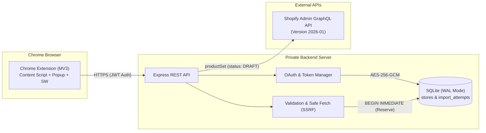

# AliExpress to Shopify One-Click Importer

A lightweight, security-first Chrome Extension that imports a single AliExpress product into a connected Shopify store as a **Draft** with one click.

> [!NOTE]
> **Current Project Phase: Milestone M1 (Scaffolding & Environment)**
>
> Phase A planning and audit remediation are complete across all 12 canonical files.
> Implementation authorization has been granted by the user. Milestone M1 is in progress.

---

## 1. Key Features

- **Single-Click Draft Import** — One-click action imports product details into Shopify strictly as a Draft (never published automatically).
- **In-Popup Product Preview** — View product thumbnail, title, extracted variant count, and image count before initiating import.
- **Currency Verification** — Strictly verifies that the AliExpress display currency matches the connected Shopify store currency before allowing import.
- **Configurable Decimal-Safe Markup** — Set a percentage markup (e.g., 30%) with commercial half-up rounding and zero floating-point arithmetic errors.
- **Option & Variant Integrity** — Accurately maps option dimensions (up to Shopify's limit of 3) and variant combinations; explicitly rejects products with > 3 options (never silently truncates).
- **Transparent Image Handling** — Attempts direct CDN pass-through with staged upload fallback; popup explicitly communicates whether all or some images imported.
- **Concurrency-Safe Duplicate Prevention** — Implements an import reservation state machine (`pending` → `completed`/`failed`/`needs_reconciliation`) to prevent duplicate creation under parallel requests or ambiguous timeouts.
- **Zero Secrets in Extension** — Shopify Admin access tokens and client secrets are stored exclusively server-side (encrypted with AES-256-GCM); the extension receives only a short-lived, exchangeable authorization token.

---

## 2. Planned System Architecture

---

## 3. Canonical Documentation Index

All planning documents in the repository root follow a strict canonical naming convention:

| Document | Purpose & Scope |
|----------|-----------------|
| [plan.md](plan.md) | High-level requirements, target user, supported product envelope, and acceptance criteria |
| [architecture.md](architecture.md) | Component architecture, data flow diagrams, security boundaries, and reservation state machine |
| [decisions.md](decisions.md) | 14 Architectural Decision Records (ADRs) covering MV3, SQLite, OAuth, currency, and images |
| [rules.md](rules.md) | 20 mandatory engineering rules governing security, money arithmetic, and scope control |
| [database-schema.md](database-schema.md) | SQLite database design (`stores`, `import_attempts`), migrations, encryption, and operations |
| [api-spec.md](api-spec.md) | Complete REST API contract, request/response schemas, error codes, and GraphQL mutations |
| [design.md](design.md) | UI/UX specification, 12 discrete popup states, ASCII wireframes, and accessibility requirements |
| [testing.md](testing.md) | Comprehensive test matrix (unit, integration, SSRF security, concurrency races, E2E) |
| [deployment.md](deployment.md) | Step-by-step development setup, production Docker/Nginx topology, disaster recovery, and backups |
| [tasks.md](tasks.md) | 86 implementation tasks organized across 10 milestones (M0–M9) with dependencies |
| [planning-audit.md](planning-audit.md) | Detailed audit report tracking all 20 findings (F-01 through F-20) and remediation status |
| [README.md](README.md) | Project summary, status, and developer orientation (this file) |

---

## 4. Technology Stack (Planned)

| Component | Technology | Rationale |
|-----------|------------|-----------|
| Chrome Extension | Manifest V3, TypeScript, HTML/CSS | Modern browser standard; native type safety |
| Backend Server | Node.js (v20+ LTS), Express.js | Lightweight modular monolith; low memory footprint |
| Database | SQLite via `better-sqlite3` (WAL mode) | Zero-configuration embedded database; ACID transactions |
| Token Encryption | AES-256-GCM (`crypto` module) | Authenticated encryption for stored Shopify access tokens |
| Shopify API | Admin GraphQL API (`2026-01`) | Synchronous `productSet` mutation creating Draft products |
| HTML Sanitization | DOMPurify (client) + `sanitize-html` (server) | Defense-in-depth XSS prevention for imported descriptions |
| Build System | esbuild | Sub-second bundle times for extension and server |
| Test Runner | Vitest | Fast, TypeScript-first test suite |

---

## 5. Development Status & Next Steps

| Phase | Milestone Range | Status | Description |
|-------|-----------------|--------|-------------|
| **Phase A** | M0 | ✅ **Complete & Audited** | Documentation and remediation complete across all 12 canonical files. |
| **Phase B** | M1–M9 | ⏳ **Awaiting Approval** | Implementation will not begin until explicit user authorization is granted. |

### How to Begin Implementation (Once Authorized)
1. User provides explicit approval to proceed to Phase B.
2. Mark task `M0-16` complete in `tasks.md`.
3. Begin with task `M1-01: Initialize git repository`.
4. Proceed strictly in dependency order as documented in `tasks.md`.

---

## 6. Merchant Legal and Compliance Notice

This extension is an automation tool designed to assist Shopify merchants in creating draft products. The merchant is solely responsible for verifying copyright, trademark, and supplier permissions for all imported images, descriptions, and text.
