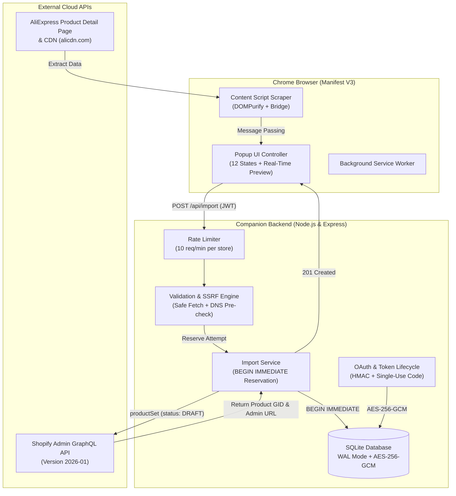

# 🚀 AliExpress to Shopify One-Click Importer

<p align="center">
  
  
  
  
  
  
  
</p>

<p align="center">
  <strong>A minimal, secure, and production-grade Chrome Extension & companion Node.js backend to import any AliExpress product directly into your connected Shopify store as a Draft with one click.</strong>
</p>

---

## 📖 Table of Contents

- [Key Features](#-key-features)
- [System Architecture](#-system-architecture)
- [Monorepo Directory Structure](#-monorepo-directory-structure)
- [Workflow & UI States](#-workflow--ui-states)
- [Security & Concurrency Protections](#-security--concurrency-protections)
- [Quick Start Guide](#-quick-start-guide)
  - [1. Prerequisites](#1-prerequisites)
  - [2. Backend Setup](#2-backend-setup)
  - [3. Shopify App Configuration](#3-shopify-app-configuration)
  - [4. Chrome Extension Installation](#4-chrome-extension-installation)
- [API Reference](#-api-reference)
- [Automated Testing](#-automated-testing)
- [Operations & Backups](#-operations--backups)
- [Canonical Documentation](#-canonical-documentation)
- [Legal & Compliance](#-legal--compliance)

---

## ✨ Key Features

| Feature | Description |
|---|---|
| **🔒 Draft-Only Guarantee** | Products are created strictly as **`DRAFT`** via Shopify Admin GraphQL `productSet`. Never automatically published, leaving the merchant in complete control. |
| **🛡️ Zero-Secret Client Architecture** | Shopify Admin access tokens, API client secrets, and signing keys are stored exclusively server-side (AES-256-GCM encrypted in SQLite). Extension receives only a short-lived bearer JWT. |
| **💵 Decimal-Safe Pricing Engine** | Uses integer-cent arithmetic and commercial half-up rounding. Configurable markup percentage (e.g., +30%) eliminates IEEE-754 floating-point drift. |
| **💱 Strict Currency Matching** | Automatically detects AliExpress display currency (ISO 4217) and compares it with your Shopify store currency. Blocks import if currencies do not match. |
| **⚡ Concurrency-Safe Reservations** | Uses SQLite `BEGIN IMMEDIATE` transactions to prevent duplicate product creation during parallel clicks, rapid re-imports, or network timeouts. |
| **🔍 Multi-Strategy Extraction** | Priority extraction chain: Injected Main-World `runParams` script &rarr; Schema.org JSON-LD &rarr; Rendered DOM scraper. |
| **📦 3-Option Limit Enforcement** | Strictly validates Shopify's limit of 3 option dimensions (e.g. Color, Size, Style). Rejects products with >3 options with an explicit warning (never silently drops variant data). |
| **🖼️ Transparent Image Accounting** | Direct CDN pass-through (`files.originalSource`). Distinguishes full image success from partial image uploads (`completed` vs. `completed_partial_images`) with explicit warnings. |
| **🛡️ SSRF & Network Protection** | Pre-resolution DNS validation blocks loopback (`127.0.0.0/8`), private (`10.0.0.0/8`, `172.16.0.0/12`, `192.168.0.0/16`), and AWS/cloud metadata (`169.254.169.254`). |

---

## 🏗️ System Architecture



---

## 📁 Monorepo Directory Structure

```
aliexpres-oneclick-import/
├── extension/                       # Chrome Extension (Manifest V3)
│   ├── manifest.json                # Pinned permissions (activeTab, scripting, storage)
│   ├── build.mjs                    # esbuild bundler script
│   ├── src/
│   │   ├── background/              # Background service worker
│   │   ├── content/                 # Scraper engine (URL parser, currency, DOMPurify, bridge)
│   │   ├── popup/                   # Polaris-inspired popup UI (HTML, CSS, State Controller)
│   │   └── shared/                  # Pricing math and shared type interfaces
│   └── tests/                       # Extension test suites (Vitest + JSDOM)
│
├── server/                          # Private Companion Backend
│   ├── package.json                 # Node.js 24 native SQLite (DatabaseSync)
│   ├── .env.example                 # Config template with dummy keys
│   ├── src/
│   │   ├── auth/                    # OAuth, HMAC verification, AES-256-GCM crypto, JWT handoff
│   │   ├── db/                      # Database initialization, SQLite pragmas, reservation transactions
│   │   ├── middleware/              # Sliding-window rate limiter & CORS origins
│   │   ├── routes/                  # Express endpoints (/auth, /api/status, /api/import, /health)
│   │   ├── services/                # Product import orchestrator & decimal pricing
│   │   ├── shopify/                 # GraphQL Admin client (2026-01), productSet, reconciliation
│   │   └── validation/              # SafeFetch SSRF guard, import schema validator, HTML sanitizer
│   └── tests/                       # 13 server test suites (unit, integration, concurrency)
│
├── data/                            # SQLite persistent volume (WAL mode)
└── *.md                             # 12 Canonical planning, architecture, and audit documents
```

---

## 📱 Workflow & UI States

The extension manages **12 discrete UI states** using Polaris-inspired styling and accessible ARIA live regions:

```
[ Disconnected ] ──(Connect Store)──> [ OAuth Callback ] ──(Store Active)──> [ Idle / Inspecting ]
                                                                                   │
       ┌───────────────────────────────┬───────────────────────────────┬───────────┴───────────┐
       ▼                               ▼                               ▼                       ▼
[ Non-AliExpress ]            [ Currency Mismatch ]          [ Unsupported Options ]      [ Extracting... ]
 (Shows guide)                 (AE: EUR ≠ Store: USD)         (> 3 Option Dimensions)          │
                                                                                               ▼
                                                                                      [ Product Preview ]
                                                                                      (Thumbnail, Title,
                                                                                       Variants, Markup,
                                                                                       Calculated Price)
                                                                                               │
                                                                                   (Click "Import to Shopify")
                                                                                               │
                                                                                               ▼
                                                                                       [ Importing... ]
                                                                                               │
                              ┌────────────────────────────────┬───────────────────────────────┤
                              ▼                                ▼                               ▼
                     [ 201 Full Success ]        [ 201 Partial Images ]              [ 409 Duplicate ]
                      (Clickable Shopify          (Clickable Draft Link +             (Link to existing
                       Admin Draft Link)           Warning: X of Y failed)             Shopify Product)
```

---

## 🔒 Security & Concurrency Protections

### 1. Zero Credentials in the Browser
No Shopify access tokens, client secrets, or private encryption keys are ever delivered to or stored inside the Chrome Extension. Stored tokens in the SQLite database are encrypted at rest using **AES-256-GCM** with a server-side 256-bit key and random initialization vectors. Disconnecting a store performs an immediate zero-fill wipe of stored ciphertext and auth tags.

### 2. Import Reservation State Machine
To guarantee that parallel clicks or rapid re-imports never result in duplicate products on Shopify:
1. `BEGIN IMMEDIATE` transaction acquires an exclusive SQLite write lock.
2. Checks existing `(store_id, source_product_id)` attempts:
   - `completed`: Returns `409 DUPLICATE_PRODUCT` with Shopify Admin link.
   - `pending` (< 5 min old): Returns `409 IMPORT_IN_PROGRESS`.
   - `pending` (stale, > 5 min old) or `needs_reconciliation`: Reconciles against Shopify before allowing a new run.
3. Network calls (`productSet` mutation) are executed **outside** the database transaction.

### 3. Ambiguous Outcome Handling
If a network timeout occurs while Shopify is executing the mutation:
- The attempt status is marked as **`needs_reconciliation`**.
- The server responds with HTTP **`502 UNKNOWN_OUTCOME`** (never auto-retrying).
- The next import status check queries Shopify via GraphQL:
  `query FindBySourceId { products(query: "metafield:custom.aliexpress_source_id:<ID>") }`.
- If found, the product is linked and marked `completed`. If not found, the attempt is cleared.

### 4. Server-Side SSRF Guard (`safeFetch`)
When downloading assets:
- **Pre-Resolution DNS Check:** Resolves domain via DNS and verifies IP does not belong to private (`10.0.0.0/8`, `172.16.0.0/12`, `192.168.0.0/16`), loopback (`127.0.0.0/8`), or link-local cloud metadata (`169.254.0.0/16`).
- **Redirect Revalidation:** Redirects are capped at 1 and re-checked against DNS rules.
- **Payload Caps:** Strictly limits responses to 10 MB and times out after 10 seconds.

---

## ⚡ Quick Start Guide

### 1. Prerequisites

- **Node.js**: v20+ LTS or v24+
- **Google Chrome**: Version 120+ (Manifest V3)
- **Shopify Partner Account / Development Store**: To create Custom App credentials.

---

### 2. Backend Setup

```bash
# 1. Clone the repository
git clone https://github.com/nizamuddin3080/Aliexpress-oneclick-import.git
cd Aliexpress-oneclick-import

# 2. Configure environment variables
cd server
cp .env.example .env

# Generate secure 32-byte hex keys for JWT and AES-256-GCM encryption:
node -e "console.log('JWT_SECRET=' + require('crypto').randomBytes(32).toString('hex'))"
node -e "console.log('ENCRYPTION_KEY=' + require('crypto').randomBytes(32).toString('hex'))"
```

Edit `server/.env` and insert your generated keys and Shopify Partner App credentials:

```ini
PORT=3456
NODE_ENV=development
BACKEND_URL=http://localhost:3456

SHOPIFY_CLIENT_ID=your_client_id_from_shopify
SHOPIFY_CLIENT_SECRET=your_client_secret_from_shopify

JWT_SECRET=your_32_byte_hex_jwt_secret
ENCRYPTION_KEY=your_32_byte_hex_encryption_key

DATABASE_PATH=./data/importer.db
SHOPIFY_API_VERSION=2026-01
SHOPIFY_SCOPES=write_products

# Chrome Extension ID from chrome://extensions
EXTENSION_ID=your_unpacked_extension_id
```

```bash
# 3. Build and run the server
npm install
npm run build
npm start
```

Verify backend health:
```bash
curl http://localhost:3456/health
# Returns: {"status":"healthy","database":"connected","active_store":null}
```

---

### 3. Shopify App Configuration

In your [Shopify Partner Dashboard](https://partners.shopify.com/):
1. Navigate to **Apps** &rarr; **Create App** &rarr; **Create app manually**.
2. Under **App setup**:
   - **App URL**: `http://localhost:3456`
   - **Allowed redirection URL(s)**: `http://localhost:3456/auth/shopify/callback`
3. Under **Access configuration**:
   - Select `write_products` scope (which implicitly includes `read_products`).
4. Copy the **Client ID** and **Client Secret** into your `server/.env`.

---

### 4. Chrome Extension Installation

1. **Build the extension bundle:**
   ```bash
   npm run build -w extension
   ```
2. **Load into Google Chrome:**
   - Open Chrome and navigate to `chrome://extensions/`.
   - Enable **Developer mode** (toggle in upper right corner).
   - Click **Load unpacked** and select the `extension/` directory (where `manifest.json` is located).
3. **Record Extension ID:**
   - Note the generated 32-character ID (e.g. `abcdefghijklmnop...`).
   - Paste it into `EXTENSION_ID` in `server/.env` and restart your backend.

---

## 📡 API Reference

All protected endpoints (`/api/*`) require:
`Authorization: Bearer <JWT>`

| Method | Endpoint | Access | Description |
|---|---|---|---|
| `GET` | `/health` | Public | Server uptime, SQLite connection status, and configuration check |
| `GET` | `/auth/shopify?shop={domain}` | Public | Initiates Shopify OAuth flow with HMAC CSRF nonces |
| `GET` | `/auth/shopify/callback` | Public | Receives OAuth code, stores encrypted token, redirects with single-use auth code |
| `POST` | `/auth/exchange` | Public | Exchanges single-use auth code (60s TTL) for 7-day bearer JWT |
| `GET` | `/api/status` | Protected | Returns connected store domain, display name, and base currency |
| `POST` | `/api/disconnect` | Protected | Secure zero-fill wipe of encrypted tokens and store deactivation |
| `GET` | `/api/import/:sourceId` | Protected | Checks whether product was imported, in-progress, or needs reconciliation |
| `POST` | `/api/import` | Protected | Reserves attempt and creates Draft product on Shopify via GraphQL `productSet` |

---

## 🧪 Automated Testing

The project maintains **100% pass rate across 130 tests**:

```bash
# Run all 130 tests across both workspaces
npm test

# Run server test suites (88 tests)
npm test -w server

# Run extension test suites (42 tests)
npm test -w extension

# Run TypeScript compiler checks
npm run typecheck
```

### Test Coverage Highlights:
- **`auth-lifecycle.test.ts`**: Single-store enforcement, OAuth token exchange, single-use auth code expiration, and zero-wipe on disconnect.
- **`import-routes.test.ts`**: Concurrency stress testing (parallel requests receiving 201 vs 409), timeout reconciliation, userErrors parsing.
- **`safe-fetch.test.ts`**: Private IP blocking (10.x, 192.168.x, 127.x, 169.254.x), DNS rebinding guard, redirect traversal rejection.
- **`pricing.test.ts`**: Integer-cent decimal math, commercial half-up rounding, currency normalization.
- **`sanitizer.test.ts`**: Stripping `<script>`, `<iframe>`, inline `onclick`, and tracking pixels from descriptions.

---

## 💾 Operations & Backups

### Live Online Backup
Because the database runs in SQLite WAL mode, backups can be taken without locking or stopping the application:
```bash
sqlite3 data/importer.db ".backup data/importer-backup-$(date +%Y%m%d).db"
```

### Integrity Verification
```bash
sqlite3 data/importer.db "PRAGMA integrity_check;"
# Expected output: ok
```

---

## 📚 Canonical Documentation

For detailed architectural specifications, review the 12 canonical markdown documents:

- [`architecture.md`](architecture.md) — System design, component responsibilities, data flow diagrams.
- [`api-spec.md`](api-spec.md) — REST API schemas, GraphQL mutations, HTTP error codes.
- [`decisions.md`](decisions.md) — 14 Architectural Decision Records (ADRs).
- [`rules.md`](rules.md) — 20 mandatory engineering standards and security constraints.
- [`database-schema.md`](database-schema.md) — SQLite table definitions, indexes, token encryption.
- [`design.md`](design.md) — UI/UX wireframes, styling guide, accessibility compliance.
- [`tasks.md`](tasks.md) — Detailed checklist of all 86 implementation tasks (M0–M9).
- [`testing.md`](testing.md) — Complete test matrix and test specifications.
- [`deployment.md`](deployment.md) — Production setup, Docker deployment, troubleshooting.
- [`planning-audit.md`](planning-audit.md) — Remediation audit report for all 20 findings.

---

## ⚖️ Legal & Compliance

- **Draft Product Enforcement**: This tool is designed solely to create Draft listings. The merchant retains ultimate responsibility for reviewing and publishing products.
- **Copyright & Content**: Merchants are responsible for ensuring they possess the appropriate licensing or permissions from suppliers for imported text, specifications, and images.
- **Fair Scraping**: Scrapes public item detail pages without bypassing CAPTCHAs, bot barriers, or private user accounts.

---

## 📄 License

Distributed under the [MIT License](LICENSE).
