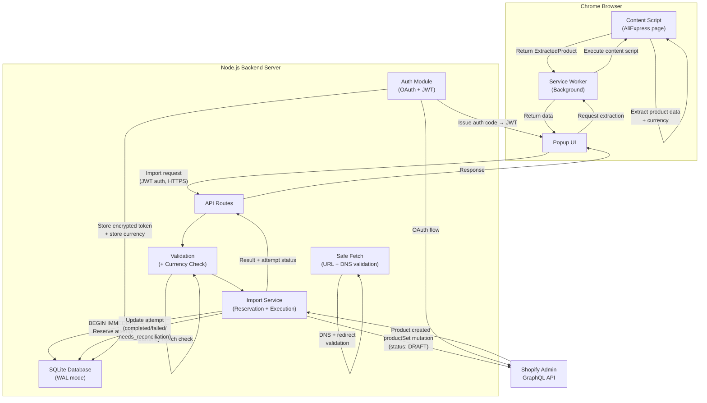
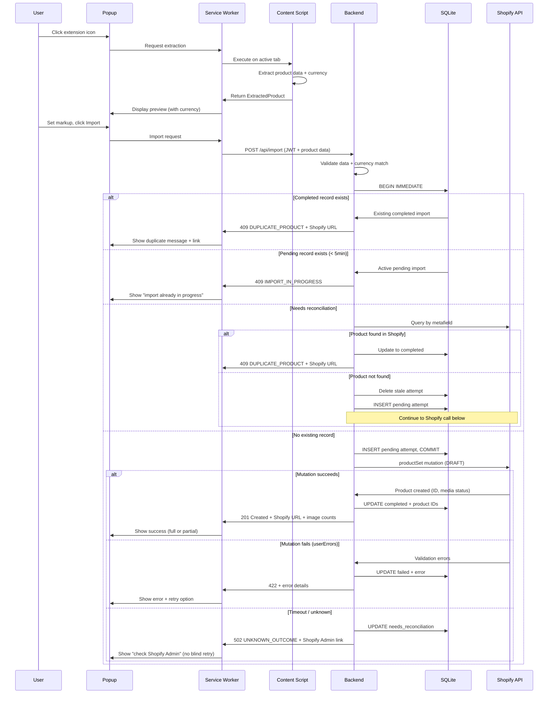
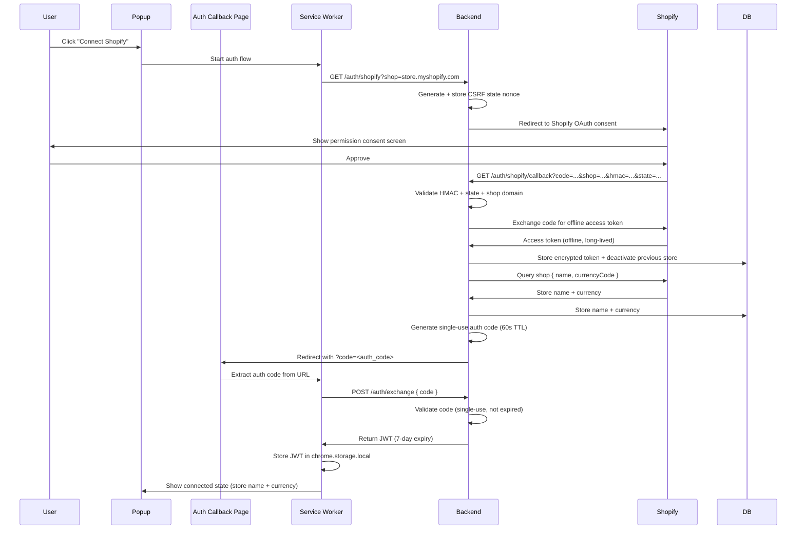
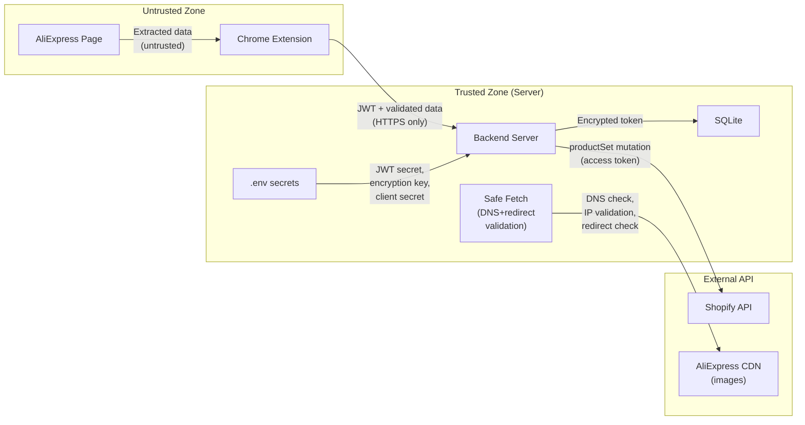

# Architecture — AliExpress to Shopify One-Click Importer

## 1. System Overview

The system consists of three components:

1. **Chrome Extension (MV3)** — Runs on AliExpress product pages. Extracts product data (including currency), displays a preview popup, and communicates with the backend.
2. **Backend Server (Node.js/Express)** — Handles Shopify OAuth, stores access tokens securely, manages import attempt lifecycle (reservation → execution → completion/reconciliation), proxies Shopify API calls, and enforces duplicate prevention.
3. **Shopify Admin GraphQL API** — External service for product creation.

The architecture is a **modular monolith**: a single Node.js server handles all backend concerns. No microservices, message queues, or distributed infrastructure.

## 2. Architecture Diagram



## 3. Component Responsibilities

### 3.1 Chrome Extension — Content Script

**File:** `extension/src/content/extractor.ts`

- Executes on AliExpress product detail pages matching URL patterns.
- Extracts product data using a multi-strategy approach:
  1. **Primary:** Parse `<script>` tags for embedded JSON data (`window.runParams`, SSR hydration state).
  2. **Secondary:** Parse `<script type="application/ld+json">` for JSON-LD Product schema.
  3. **Tertiary:** DOM element extraction (title, price, image elements).
- **Currency extraction:** Identifies the displayed currency from JSON-LD `priceCurrency`, page metadata, or visible currency symbols/codes. Currency is a required extracted field.
- Uses bridge script injection to access main-world JavaScript variables from the isolated content script world.
- Sanitizes extracted HTML (product descriptions) using DOMPurify.
- Returns structured `ExtractedProduct` data to the service worker via `chrome.runtime.sendMessage`.
- Does **not** communicate directly with the backend or Shopify.

**URL Match Patterns:**
```
*://*.aliexpress.com/item/*.html*
*://*.aliexpress.ru/item/*.html*
```

### 3.2 Chrome Extension — Service Worker (Background)

**File:** `extension/src/background/service-worker.ts`

- Listens for messages from the popup and content scripts.
- Orchestrates extraction by injecting/executing the content script on the active tab.
- Manages JWT token storage in `chrome.storage.local`.
- Forwards authenticated API requests to the backend server over HTTPS.
- Handles the Shopify OAuth auth-code exchange: receives the short-lived auth code from the callback page, exchanges it for a JWT via `POST /auth/exchange`.
- No persistent state — ephemeral per MV3 requirements.

### 3.3 Chrome Extension — Popup UI

**File:** `extension/src/popup/popup.ts`, `popup.html`, `popup.css`

- 400×520px compact popup activated by clicking the extension icon.
- Displays connection status, product preview (with currency), markup input, and import button.
- States: Disconnected → Connected (idle/non-AliExpress page) → Extracting → Preview → Importing → Success / Partial Success / Error / Duplicate / Unsupported Product / Reauthorization Required.
- Shows source currency, source price, markup, and selling price with explicit currency codes.
- Communicates with the service worker via `chrome.runtime.sendMessage`.
- Does **not** communicate directly with the backend (all requests go through the service worker).
- **Never offers a blind retry after an ambiguous import outcome.** If the backend returns `needs_reconciliation`, the popup shows "Import status unknown — check Shopify Admin" with a link.

### 3.4 Backend — Auth Module

**Files:** `server/src/auth/oauth.ts`, `server/src/auth/jwt.ts`

- Implements Shopify OAuth Authorization Code flow for offline access tokens:
  1. `GET /auth/shopify` — Generates CSRF state nonce, stores it, redirects to Shopify authorization page.
  2. `GET /auth/shopify/callback` — Validates HMAC + state nonce + shop domain, exchanges authorization code for offline access token, stores encrypted token in SQLite, queries `shop { name, currencyCode }` and stores result, generates short-lived single-use auth code (60s TTL).
  3. Redirects to `chrome-extension://<EXTENSION_ID>/src/popup/auth-callback.html?code=<auth_code>`.
  4. `POST /auth/exchange` — Extension exchanges auth code for JWT. Code is single-use and deleted after exchange.
- Issues JWTs containing: `{ storeDomain, storeId, iat, exp }` with 7-day expiry.
- Validates JWTs on every authenticated request.
- **Single-store behavior:** Connecting a new store deactivates the previous store (`is_active = 0`).
- **Reauthorization:** If Shopify returns 401 for a stored token, the backend returns 401 with `reauthorization_required: true` to the extension.

### 3.5 Backend — API Routes

**Files:** `server/src/routes/import.ts`, `server/src/routes/status.ts`

| Method | Path | Auth | Description |
|--------|------|------|-------------|
| GET | `/auth/shopify` | No | Initiate Shopify OAuth |
| GET | `/auth/shopify/callback` | No | OAuth callback (HMAC + state validated) |
| POST | `/auth/exchange` | No | Exchange single-use auth code for JWT |
| GET | `/api/status` | JWT | Check connection status, return store name + currency |
| POST | `/api/import` | JWT | Import product to Shopify (with reservation) |
| GET | `/api/import/:sourceId` | JWT | Check if product already imported or in-progress |

### 3.6 Backend — Import Service

**File:** `server/src/services/import-service.ts`

Import lifecycle (see database-schema.md for state machine):

1. **Validate** product data (title, prices, currency, URLs, options, images).
2. **Check currency match** between `source_currency` and stored `store_currency`.
3. **Reserve** import attempt: `BEGIN IMMEDIATE` → `INSERT import_attempts (status='pending')` → `COMMIT`. If an existing `completed` record exists, return `409 DUPLICATE`. If a `pending` record exists (< 5 min old), return `409 IMPORT_IN_PROGRESS`. If a `needs_reconciliation` record exists, attempt reconciliation first.
4. **Apply markup** to all variant prices using decimal-safe arithmetic.
5. **Construct** `productSet` mutation input: title, descriptionHtml, vendor, `status: DRAFT`, productOptions, variants with marked-up prices, files (image URLs), metafields (source product ID and URL).
6. **Execute** `productSet` mutation against Shopify Admin GraphQL API.
7. **On success:** Update attempt to `completed` with `shopify_product_id`, `shopify_admin_url`, `images_succeeded`.
8. **On definitive Shopify error** (userErrors): Update attempt to `failed` with error message. The failed record can be deleted to allow retry.
9. **On timeout/unknown:** Update attempt to `needs_reconciliation`. Return uncertain status to extension.
10. **Reconciliation:** When a `needs_reconciliation` record is found, query Shopify for products with `custom.aliexpress_source_id` metafield matching the source ID. If product found → update to `completed`. If not found → delete the attempt to allow retry.

### 3.7 Backend — Validation Module

**File:** `server/src/validation/product-validator.ts`

Validates incoming product data from the extension:

| Field | Validation |
|-------|-----------|
| `title` | Non-empty string, max 255 chars |
| `description_html` | Sanitized HTML, max 50,000 chars; scripts/event handlers removed |
| `images` | 1–50 items; each URL HTTPS only; hostname matches alicdn.com allowlist |
| `source_url` | HTTPS only; hostname matches AliExpress allowlist |
| `source_product_id` | Non-empty string, numeric |
| `source_currency` | Required; valid ISO 4217 currency code |
| `options` | 0–3 items; each `name` non-empty; each `values` non-empty array |
| `variants` | Required if options present; 1–2000 items; each has valid `option_values` and positive `price` |
| `markup_percentage` | Number ≥ 0 and ≤ 1000 |

**Rejection rules:**
- Missing required fields → 400 with field-level errors.
- More than 3 option types → 400 "Shopify supports a maximum of 3 option types."
- Source currency doesn't match store currency → 400 "Currency mismatch."
- Invalid URL domain → 400 with specific URL error.

### 3.8 Backend — Safe Fetch Module

**File:** `server/src/validation/safe-fetch.ts`

Used for any server-side URL fetching (image download fallback, URL validation):

- **Protocol:** HTTPS only.
- **Hostname allowlist:** Exact suffix match against approved domains (e.g., `.alicdn.com`).
- **DNS resolution check:** After resolving the hostname, verify the IP is not in private (10.x, 172.16–31.x, 192.168.x), loopback (127.x), link-local (169.254.x), or reserved ranges. This prevents SSRF via DNS rebinding.
- **Redirect policy:** Do not follow redirects, or follow max 1 redirect with the same hostname/IP/protocol checks applied to the redirect target.
- **No credentials in URLs** (`user:pass@host` rejected).
- **Content-Type validation:** Must match expected type (e.g., `image/*`).
- **Size limit:** Max 10 MB per fetch.
- **Timeout:** 10 seconds.
- **Reuse:** The same `safeFetch` function is used for both URL validation (HEAD) and actual download (GET).

### 3.9 Backend — SQLite Database

**File:** `server/src/db/database.ts`

- Two tables: `stores` and `import_attempts` (see `database-schema.md`).
- Uses `better-sqlite3` for synchronous, embedded SQLite access in **WAL mode**.
- `BEGIN IMMEDIATE` transactions for import reservation (serializes concurrent writes).
- Encrypted access token storage using AES-256-GCM with server-side encryption key.
- Migrations managed via versioned SQL scripts.

## 4. Data Flow — Product Import



## 5. Shopify Authentication Flow



## 6. Image Handling

1. Extract image URLs from AliExpress page data.
2. Validate URLs: HTTPS only, hostname matches alicdn.com allowlist, no credentials in URL.
3. Pass image URLs to Shopify's `productSet` mutation via the `files` field with `originalSource`.
4. Shopify's media pipeline fetches and hosts the images.
5. **Fallback:** If Shopify returns image-specific errors (media processing failure), download images server-side using the safe-fetch module and use Shopify's staged upload API (`stagedUploadsCreate` → upload → reference in `productSet`).
6. **Outcome tracking:** Response includes `images_requested`, `images_succeeded`, and `images_failed`.

**Image outcome semantics (see ADR-010):**
- All images succeed → full success.
- Some images fail → partial success, product created, warning shown.
- All images fail → product created, prominent warning shown.
- Image failure never blocks product creation.

## 7. Variant Mapping

AliExpress variant data structure → Shopify `productSet` input:

| AliExpress | Shopify `productSet` |
|------------|---------------------|
| SKU property name (e.g., "Color") | `productOptions[].name` |
| SKU property value (e.g., "Red") | `productOptions[].values[].name` |
| SKU combination | `variants[].optionValues[]` |
| SKU price | `variants[].price` (after markup, as string) |
| SKU ID / code | `variants[].sku` |

- Each unique property name becomes a Shopify product option.
- Each variant maps to a combination of option values.
- Shopify supports up to 3 options and 2,000 variants per product.
- **If AliExpress product has more than 3 option types, the import is rejected** (not truncated). See ADR-014.
- Every variant must have a valid positive price. Missing prices block the import.
- Variant-option-value combinations are validated for completeness before the mutation.

## 8. Duplicate Prevention

See ADR-008 for the full import reservation pattern.

Summary:
1. **Reserve** import attempt in SQLite with `BEGIN IMMEDIATE` transaction.
2. **If `completed` record exists:** Return existing `shopify_product_id` and admin URL. Do not call Shopify API.
3. **If `pending` record exists (< 5 min old):** Return "import in progress."
4. **If `needs_reconciliation`:** Query Shopify by metafield. If product found → complete. If not → delete stale attempt and allow new reservation.
5. **If no record:** Create `pending` record, proceed with `productSet` mutation.
6. **After successful creation:** Update to `completed` with Shopify product IDs.
7. **Secondary source of truth:** AliExpress source URL stored in Shopify product metafield (`custom.aliexpress_source_id`).

## 9. Error Handling Strategy

| Error Type | Response Code | Recovery | Retryable? |
|------------|--------------|----------|------------|
| Unsupported page | N/A (extension-side) | User navigates to correct page | N/A |
| Extraction failure | N/A (extension-side) | User reports issue or tries different product | N/A |
| Currency unknown | 400 | User ensures AliExpress displays a recognized currency | Yes (after fix) |
| Currency mismatch | 400 | User changes AliExpress currency to match store | Yes (after fix) |
| Validation failure | 400 | User corrects data or reports issue | Yes (after fix) |
| Unsupported product (>3 options) | 400 | Product cannot be imported (documented limitation) | No |
| Duplicate detected | 409 | User views existing product via link | No |
| Import in progress | 409 | User waits for current import to complete | Wait |
| Shopify auth revoked | 401 | Extension triggers re-authentication | Yes (after reauth) |
| Shopify validation error | 422 | User reviews error, may need to edit data | Maybe |
| Shopify rate limit | 429 | Auto-retry with backoff (server-side) | Yes (automatic) |
| Image partial failure | 201 (partial) | Product created; images can be added manually in Shopify | N/A |
| Network failure | 502/504 | User retries after connectivity restored | Yes |
| Unknown mutation outcome | 502 | User checks Shopify Admin; backend reconciles on next attempt | **No blind retry** |
| Partial creation failure | N/A | Attempt marked `needs_reconciliation`; reconciled before next attempt | Reconcile first |

**Critical rule:** The extension **never** offers a "retry" button after an `UNKNOWN_OUTCOME` response. It shows "Import status is uncertain — please check Shopify Admin" with a link. The backend reconciles on the next import attempt for the same product.

## 10. Security Boundaries



- **Secrets in `.env` only:** `SHOPIFY_CLIENT_ID`, `SHOPIFY_CLIENT_SECRET`, `JWT_SECRET`, `ENCRYPTION_KEY`.
- **No secrets in extension:** The extension only stores a JWT (which contains no Shopify credentials).
- **HTTPS required:** All extension↔backend communication must use HTTPS (except `localhost` in development).
- **HTTPS for source URLs:** AliExpress product URLs and image URLs must use HTTPS.
- **CORS:** Backend allows requests only from the configured extension origin.
- **Safe fetch:** All server-side URL fetching uses the safe-fetch module with DNS resolution checks, redirect validation, and IP range blocking.
- **Auth codes:** Short-lived (60s), single-use, stored in-memory only.

## 11. Technology Choices

| Component | Technology | Rationale |
|-----------|-----------|-----------|
| Extension | Chrome MV3 + TypeScript | Current standard, type safety |
| Popup UI | Plain HTML/CSS/TS | No framework needed for a single-page popup |
| Backend runtime | Node.js 20+ | JavaScript ecosystem alignment |
| Backend framework | Express.js | Minimal, well-understood, low overhead |
| Database | SQLite via better-sqlite3 (WAL mode) | Zero-config, embedded, synchronous API for transaction control |
| Shopify API | GraphQL Admin API (version verified at implementation start) | `productSet` support, recommended path |
| HTML sanitization | DOMPurify (extension) + sanitize-html (server) | Defense-in-depth |
| JWT | jsonwebtoken | Standard Node.js JWT library |
| Encryption | Node.js crypto (AES-256-GCM) | Built-in, no external dependency |
| Money arithmetic | Integer cents or decimal.js | Avoid floating-point money errors |
| Build tool | esbuild | Fast, simple bundling for extension and server |
| Testing | Vitest | Fast, TypeScript-native test runner |

## 12. Alternatives Considered

| Alternative | Why rejected |
|-------------|-------------|
| Extension-only (no backend) | Cannot securely store Shopify tokens or manage import reservations |
| React/Vue for popup | Overkill for a single compact UI |
| PostgreSQL | Overkill for single-store, single-server |
| REST Admin API | GraphQL is Shopify's recommended path; `productSet` is GraphQL-only |
| Webpack | Slower and more complex than esbuild for this use case |
| Puppeteer for extraction | Extension content scripts are sufficient; Puppeteer adds heavy dependency |
| Following HTTP redirects during image fetch | SSRF risk; rejected in favor of strict no-redirect or single-validated-redirect |

## 13. Known Limitations

1. **AliExpress page structure instability:** Extraction may break when AliExpress updates their frontend. Requires maintenance.
2. **Single-store only:** Architecture supports one active Shopify store per backend instance. Connecting a second store deactivates the first.
3. **No real-time sync:** Products are imported once. Price/stock changes are not tracked.
4. **Image reliability:** Image import depends on Shopify's ability to fetch from AliExpress CDN. Partial image failures are possible and reported.
5. **3-option limit:** Products with more than 3 option types are rejected (not truncated).
6. **Currency matching required:** Source currency must match Shopify store currency. No automatic conversion.
7. **Service worker ephemerality:** MV3 service workers can be terminated. All long-running operations are handled server-side.
8. **Content/copyright responsibility:** The tool copies text and images from AliExpress. Users are responsible for ensuring they have the right to reuse imported content.
