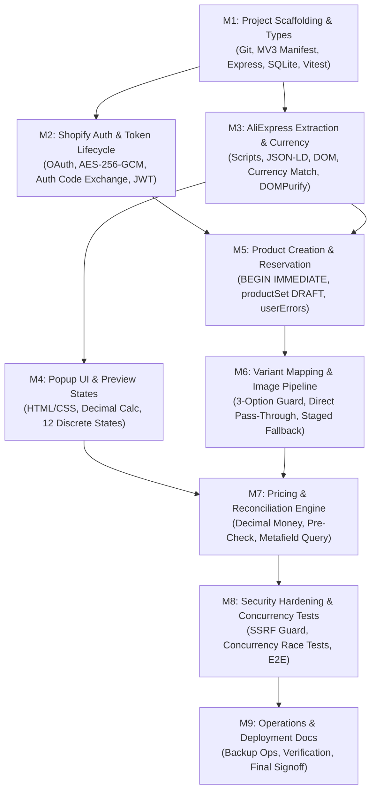

# Planning Audit Report — AliExpress to Shopify One-Click Importer

**Document Version:** 2.0 (Post-Remediation Audit)  
**Audit Date:** 2026-10-29  
**Audit Scope:** Comprehensive cross-document consistency, requirements, security, concurrency, and implementation-readiness review across all 12 canonical Markdown planning files.  
**Phase Status:** **Phase A (Planning & Remediation) Complete.** Phase B (Implementation) has **NOT** started. Zero application source files exist.

---

## 1. Executive Summary

An initial inspection revealed that while the proposed Manifest V3 + Node.js/Express + SQLite architecture was appropriately lightweight for a single-store Draft importer, the original documentation contained critical ambiguities, security gaps, and concurrency risks. 

A rigorous remediation was executed across all planning documents, addressing all 20 specific findings identified in the audit. The architecture now incorporates:
1. An **import reservation pattern** with SQLite `BEGIN IMMEDIATE` write-serialization to guarantee concurrency safety and prevent duplicate products under parallel clicks or network timeouts.
2. A strict **currency contract** that verifies source AliExpress currency against the store's base currency and mandates decimal-safe arithmetic.
3. An **offline access token OAuth model** using the modern Shopify Dev Dashboard with a short-lived, exchangeable authorization code handoff.
4. A strict **3-option rejection policy** preventing silent product corruption.
5. A **transparent image accounting model** distinguishing full success from partial image failures.
6. Full **SSRF hardening** for server-side fetches including DNS IP-range checks, loopback filtering, and redirect revalidation.

All 12 documents now reflect a unified, enforceable technical baseline.

---

## 2. Audit Remediation Tracking Matrix (All 20 Findings)

| ID | Priority | Finding Description | Affected Documents | Remediation Action Taken | Status in Docs |
|---|---|---|---|---|---|
| **F-01** | **P0** | Duplicate prevention unsafe under concurrency & timeouts | `architecture.md`, `database-schema.md`, `api-spec.md`, `decisions.md`, `tasks.md`, `rules.md` | Designed `import_attempts` table with reservation states (`pending`, `completed`, `failed`, `needs_reconciliation`). Uses `BEGIN IMMEDIATE` transaction. | ✅ Remediated |
| **F-02** | **P0** | Price currency missing from import contract | `plan.md`, `api-spec.md`, `design.md`, `decisions.md`, `testing.md`, `rules.md` | Added `sourceCurrency` to extracted data & API contract; compares with Shopify store base currency; blocks import on mismatch; mandates decimal-safe arithmetic. | ✅ Remediated |
| **F-03** | **P0** | Auth flow & token lifecycle underspecified | `decisions.md`, `architecture.md`, `database-schema.md`, `deployment.md`, `api-spec.md` | Unified on Shopify Dev Dashboard Custom App OAuth with offline access tokens; schema updated with `stores` token fields; defined revocation & re-auth. | ✅ Remediated |
| **F-04** | **P0** | Variant truncation silently drops options | `plan.md`, `architecture.md`, `rules.md`, `design.md`, `tasks.md`, `testing.md` | Established strict policy: products with > 3 options are **rejected** with explicit UI state before mutation; silent truncation prohibited. | ✅ Remediated |
| **F-05** | **P0** | Image success criteria conflict with partial success | `README.md`, `plan.md`, `architecture.md`, `decisions.md`, `api-spec.md`, `design.md` | Formalized image outcome semantics: `completed` vs `completed_partial_images`; surfaces exact requested/succeeded/failed counts in UI and API response. | ✅ Remediated |
| **F-06** | **P1** | API retry rules repeat non-idempotent creation | `api-spec.md`, `architecture.md`, `tasks.md`, `rules.md` | Prohibited automatic retries of `productSet`; timeout marks attempt as `needs_reconciliation`; retry triggers Shopify query by source ID metafield before new reservation. | ✅ Remediated |
| **F-07** | **P1** | OAuth callback exposes JWT in URL fragment | `api-spec.md`, `architecture.md`, `decisions.md`, `deployment.md`, `tasks.md` | Replaced fragment handoff with single-use authorization code (32-byte hex, 60s TTL), exchanged via `POST /auth/exchange` for a 7-day JWT. | ✅ Remediated |
| **F-08** | **P1** | SSRF protections need DNS resolution & redirect checks | `rules.md`, `architecture.md`, `api-spec.md`, `testing.md`, `tasks.md` | Defined `safeFetch` engine: resolves DNS, blocks private/loopback/link-local/multicast IP ranges, validates Content-Type/size, re-checks redirects. | ✅ Remediated |
| **F-09** | **P1** | URL validation tests allowed HTTP source URLs | `testing.md`, `rules.md`, `api-spec.md`, `plan.md` | Enforced HTTPS-only requirement for AliExpress source URLs and image CDN URLs; updated test specifications so HTTP URLs fail. | ✅ Remediated |
| **F-10** | **P1** | Validation & API limits misaligned with limits | `plan.md`, `api-spec.md`, `rules.md`, `decisions.md`, `tasks.md` | Defined single supported MVP envelope (title 255 chars, description 50KB, max 3 options, max 2000 variants, max 50 images @ 10MB each, 1MB JSON body). | ✅ Remediated |
| **F-11** | **P1** | Shopify API version freshness verification | `decisions.md`, `deployment.md`, `plan.md`, `architecture.md` | Pinned `2026-01` with explicit task in M5 to verify against live changelog before coding; documented no-auto-upgrade policy in ADR-009. | ✅ Remediated |
| **F-12** | **P1** | Ambiguous multi-store vs single-store behavior | `database-schema.md`, `rules.md`, `plan.md`, `decisions.md`, `deployment.md` | Explicitly defined single-store active model: connecting Store B marks Store A as `is_active = 0`; disconnect wipes token; documented in ADR-013. | ✅ Remediated |
| **F-13** | **P1** | Extension ID setup fragile across dev & prod | `deployment.md`, `api-spec.md`, `decisions.md`, `tasks.md` | Documented distinct dev (unpacked ID) and prod (published ID) configurations; backend validates pinned `EXTENSION_ID` and never accepts arbitrary redirect. | ✅ Remediated |
| **F-14** | **P1** | API does not distinguish full, partial, and uncertain | `api-spec.md`, `design.md`, `architecture.md` | Added discrete outcome codes: `completed`, `completed_partial_images`, `needs_reconciliation`, `failed`; each with explicit UI representations and retry flags. | ✅ Remediated |
| **F-15** | **P1** | Unexplained metafields test in testing suite | `testing.md` | Scoped metafield testing strictly to internal source tracking (`custom.aliexpress_source_*`); removed arbitrary merchant metafield test cases. | ✅ Remediated |
| **F-16** | **P2** | Previous audit overstated confidence | `planning-audit.md` | Completely replaced previous audit report with this comprehensive, transparent finding-by-finding evaluation and honest risk assessment. | ✅ Remediated |
| **F-17** | **P2** | Uploaded filenames differed from canonical links | All 12 files | Normalized all references to canonical filenames (`plan.md`, `architecture.md`, `decisions.md`, etc.); confirmed flat root repository layout. | ✅ Remediated |
| **F-18** | **P2** | Task estimates & planning baseline lacked evidence | `tasks.md` | Re-anchored tasks with dependencies (M0-01 through M9-06); gated Phase B on explicit task `M0-16`; linked to ADRs and specs. | ✅ Remediated |
| **F-19** | **P2** | Operational logging, retention, & backups high-level | `database-schema.md`, `deployment.md`, `rules.md` | Added concrete SQLite backup command (`sqlite3 .backup`), integrity verification (`PRAGMA integrity_check`), persistent volume mandate, and token wiping. | ✅ Remediated |
| **F-20** | **P2** | Merchant copyright & source responsibility unstated | `plan.md`, `rules.md`, `README.md` | Added explicit Merchant Legal and Compliance Notice advising users that they are responsible for supplier rights and content reuse permissions. | ✅ Remediated |

---

## 3. Final Proposed Architecture

The system is organized as a **modular monolith** with three well-defined tiers:

1. **Chrome Extension (Client Tier):**
   - **Content Script:** Injects bridge script to access AliExpress page state (`window.runParams`, JSON-LD, rendered DOM); extracts title, sanitized description, options, variants, prices, and ISO 4217 currency.
   - **Popup UI:** 400×520px interface handling 12 distinct states; displays explicit currency codes, live decimal-safe markup pricing, and actionable status links.
   - **Service Worker:** Ephemeral MV3 background worker managing message passing, short-lived auth code exchange, and JWT persistence in `chrome.storage.local`.

2. **Backend Companion Server (Application Tier):**
   - **Auth Module:** Manages Shopify OAuth (offline tokens), HMAC validation, CSRF nonce generation, and short-lived auth code exchange for JWTs.
   - **Validation & Safe Fetch Engine:** Validates product envelope constraints and enforces SSRF protections (DNS resolution checks, private IP filtering, redirect revalidation).
   - **Import Reservation Service:** Coordinates the pre-mutation reservation in SQLite, executes the Shopify `productSet` mutation, and resolves ambiguous outcomes via reconciliation queries.
   - **SQLite Database (WAL Mode):** Embedded ACID storage with AES-256-GCM encrypted access tokens and import attempt records.

3. **External Tier:**
   - **Shopify Admin GraphQL API (2026-01):** Executes synchronous `productSet` mutations creating products strictly in `status: DRAFT`.

---

## 4. Technical Risks Analysis

| # | Risk | Severity | Residual Impact | Mitigation Strategy |
|---|------|----------|-----------------|---------------------|
| **R1** | AliExpress page layout or script obfuscation changes | **Critical** | Product extraction fails on newly deployed AliExpress pages | Multi-strategy extraction fallback chain (State Script → JSON-LD → Rendered DOM); clear diagnostic errors in popup |
| **R2** | Shopify media pipeline blocked by AliExpress CDN hotlink protection | **High** | Products created without images or partial images | Direct URL pass-through tested in M6-05; staged upload fallback (`stagedUploadsCreate`) ready in M6-06 |
| **R3** | Ambient network drop during Shopify mutation execution | **High** | Product created in Shopify but backend times out before receiving confirmation | Attempt flagged as `needs_reconciliation`; blind retries disabled in UI; automatic reconciliation queries Shopify before subsequent attempts |
| **R4** | Merchant AliExpress currency differs from Shopify store currency | **Medium** | Extracted prices would be applied in the wrong currency | Source currency extracted; compared with cached store currency; import blocked on mismatch |
| **R5** | Content script main-world isolation prevents variable access | **Low** | Unable to read `window.runParams` directly | Bridge script DOM injection pattern communicates with content script via custom events |
| **R6** | Shopify API version deprecation over time | **Low** | GraphQL schema incompatibilities | Pinned stable version (`2026-01`); documented upgrade procedure in ADR-009 |

---

## 5. Security & Privacy Audit Findings

1. **Zero Credential Exposure:** Shopify Admin access tokens, client secrets, JWT secrets, and AES encryption keys exist solely on the server in `.env` or encrypted database storage. No secrets exist in extension code or extension storage.
2. **SSRF Hardening:** Server-side fetches perform DNS resolution prior to connection and block loopback (`127.0.0.0/8`), private (`10.0.0.0/8`, `172.16.0.0/12`, `192.168.0.0/16`), link-local (`169.254.0.0/16`), and multicast addresses. Redirects are capped at 1 and re-validated.
3. **Cross-Site Scripting (XSS) Prevention:** HTML descriptions are sanitized client-side using DOMPurify and re-sanitized server-side using `sanitize-html`.
4. **Cross-Site Request Forgery (CSRF):** OAuth initiation generates a cryptographically random `state` nonce validated upon callback.
5. **No Blind Retries:** Ambiguous mutation outcomes are protected against duplicate creation by requiring reconciliation prior to retrying.
6. **Token Destruction:** Disconnecting a store overwrites encrypted token fields in SQLite with zeroes prior to deactivation.

---

## 6. Implementation Dependency Order

**Recommended Immediate Next Step:** Task **`M1-01: Initialize git repository`**, followed by scaffolding and TypeScript strict mode configuration.

---

## 7. Phase B Authorization Status

> [!NOTE]
> **Phase B Authorized:** The user has officially approved the planning documents and authorized implementation.
> Work begins strictly on **Milestone M1 (Project Scaffolding and Development Environment)**.
> Task `M0-16` is marked complete in `tasks.md`.
